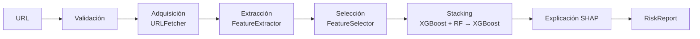

# Agente de IA para evaluar el riesgo de phishing en sitios web

Agente que recibe una URL y estima su riesgo de phishing **sin depender de listas negras**. Analiza rasgos de la URL, del dominio y (cuando el sitio responde) del HTML, aplica un *stacking* de XGBoost y Random Forest con un meta-clasificador XGBoost, y devuelve un informe con la probabilidad, el nivel de riesgo, una recomendación y las variables que motivaron la decisión (valores SHAP).

Proyecto de la asignatura **Mecanismos de Seguridad Informática**, Universidad Distrital Francisco José de Caldas.

> **Prototipo académico.** No está pensado para tomar decisiones de seguridad en producción. Con los datos actuales tiene una tasa de falsos positivos de 7,7 % y artefactos conocidos en el dataset (ver [Limitaciones](#limitaciones)).

> **Aviso de seguridad.** Las URLs de phishing que el notebook recolecta son reales y estaban activas. **No las abras en el navegador.** El agente solo descarga el HTML como texto, sin ejecutar JavaScript.

## Qué hace



1. **Adquisición:** descarga el HTML y consulta la antigüedad del dominio (WHOIS), con límites de tiempo, tamaño y redirecciones.
2. **Extracción:** 29 características (19 léxicas de la URL, 1 de dominio y 9 de HTML). Lo que no se puede calcular queda con el valor centinela `-1`.
3. **Selección:** importancia promedio normalizada de XGBoost, LightGBM y Random Forest; se conservan 17 de las 29 variables.
4. **Modelo:** XGBoost y Random Forest generan una probabilidad cada uno; un segundo XGBoost, más pequeño, las combina. El meta-clasificador se entrena con predicciones fuera de muestra agrupadas por dominio.
5. **Explicación:** valores SHAP sobre el modelo completo (no solo el meta-clasificador).
6. **Informe:** `RiskReport` con etiqueta, probabilidad, nivel de riesgo (bajo, medio o alto), recomendación, factores y variables faltantes.

## Resultados

Datos: 19.989 URLs (10.000 de phishing y 9.989 legítimas) en 18.058 dominios. Se apartó el 20 % de los dominios como prueba final (4.023 URLs); el resto se usó para ajustar hiperparámetros y validar (10 particiones agrupadas por dominio).

| Modelo (prueba final) | Exactitud | Precisión | Recall | F1 | FPR | AUC |
|---|---|---|---|---|---|---|
| Stacking | 0,9123 | 0,9220 | 0,9014 | 0,9116 | 0,0768 | 0,9668 |
| XGBoost | 0,9103 | 0,9225 | 0,8965 | 0,9093 | 0,0758 | 0,9671 |
| Random Forest | 0,9036 | 0,9117 | 0,8945 | 0,9030 | 0,0873 | 0,9634 |

- La ventaja del stacking sobre XGBoost (0,20 puntos) está dentro del error de medición (error estándar de unos 0,45 puntos).
- Un análisis completo tarda 2,83 s en promedio (1,58 s sin la explicación SHAP), sobre 20 URLs y en un runtime de Colab con 2 CPU.
- Las cifras no son comparables de forma directa con las de trabajos que usan UCI o Mendeley (96 a 99 %): aquí las características se calculan desde URLs crudas. La comparación detallada está en el paper.

## Limitaciones

- **Artefactos del dataset:** las URLs legítimas salen de Tranco y se construyeron como `https://dominio/`, sin `www`. Por eso `uses_https` y `num_subdomains` (las dos variables más importantes) capturan en parte cómo se armó la clase legítima. Un ejemplo es que `https://www.wikipedia.org/` se clasifica como phishing (probabilidad 0,89). La exactitud probablemente está sobrestimada.
- **Falsos positivos altos:** 7,7 %, es decir, una de cada 13 URLs legítimas queda marcada.
- **Poco peso del contenido:** el 79 % de las URLs de phishing ya no devolvía HTML al descargarlas; las variables de contenido aportan el 5,9 % de la importancia.
- **Sin evaluación temporal:** todas las URLs se capturaron el mismo día, y casi todas las de phishing vienen de una sola fuente.
- **Evasión:** las pruebas son simples y no adaptativas; no demuestran robustez.
- **Alcance:** solo analiza URLs públicas `http` y `https`. Las direcciones internas y las rutas protegidas se rechazan por diseño.

## Cómo usarlo

### En Google Colab

1. Abre `agente_phishing.ipynb` en Colab: [](https://colab.research.google.com/github/TU_USUARIO/TU_REPOSITORIO/blob/main/agente_phishing.ipynb)
2. Ejecuta primero con `FAST_MODE = True` (celda 0.2): hace una corrida pequeña para comprobar que todo funciona.
3. Para el experimento completo pon `FAST_MODE = False`. Recolectar y descargar miles de URLs tarda de decenas de minutos a un par de horas; el avance se guarda en Drive y se reanuda si la sesión se cae.

El notebook guarda todo en `MyDrive/phishing_agent/`:

```
phishing_agent/
├── requirements.txt            # versiones usadas en la sesión
├── dataset/{fast|full}/        # URLs y características (se reconstruyen con el notebook)
├── artefactos/{fast|full}/     # model.joblib, manifest.json (con hash SHA-256), background.csv
└── resultados/{fast|full}/     # métricas, SHAP global, evasión, tiempos, entorno.json
```

Variable opcional: `PHISHTANK_APP_KEY` para sumar PhishTank como fuente de phishing.

### Analizar una URL

Después de entrenar (o de cargar los artefactos guardados):

```python
agent = PhishingAgent.from_artifacts(ART_DIR)
informe = agent.analyze("https://ejemplo.com/login")
print(informe.to_dict())
```

Forma del informe (valores ilustrativos):

```json
{
  "url": "http://sitio-ejemplo.test/verify?id=***",
  "final_url": "http://sitio-ejemplo.test/verify?id=***",
  "label": "phishing",
  "probability": 0.93,
  "risk_level": "alto",
  "recommendation": "No ingresar credenciales ni datos personales en este sitio.",
  "factors": [
    {"feature": "uses_https", "value": 0.0, "shap": 0.24},
    {"feature": "domain_age_days", "value": 3.0, "shap": 0.18}
  ],
  "missing_features": [],
  "model_version": "a3f9c1d2e4b5"
}
```

Los valores de los parámetros de consulta se enmascaran en el informe. Si la URL no es válida, el agente responde con `label: "error"` sin haber tocado la red.

## Medidas de seguridad del agente

El agente descarga páginas hostiles, así que asume que todo lo que viene de la red no es confiable:

| Riesgo | Medida |
|---|---|
| Ejecutar código del sitio | Solo descarga el HTML y lo analiza como texto; no renderiza ni ejecuta JavaScript |
| Acceso a recursos internos (SSRF) | Solo `http` y `https`; rechaza IP privadas, de loopback y link-local, y repite la validación en cada redirección |
| Respuestas lentas o enormes | Tiempos límite (conexión, lectura y total), tope de 2 MB, máximo 5 redirecciones |
| Interacción con formularios | Solo los lee; no los rellena ni los envía |
| Modelo manipulado | Verifica el hash SHA-256 antes de cargar el modelo con `joblib` |
| Datos sensibles en la URL | Enmascara los parámetros de consulta en informes y registros |

Riesgo residual conocido: *DNS rebinding* (la IP se valida antes de conectar, no durante la conexión).

## Datos

El repositorio **no incluye el dataset**; el notebook lo reconstruye:

- **Phishing:** [Phishing.Database](https://github.com/mitchellkrogza/Phishing.Database) (lista de enlaces activos) y OpenPhish (feed comunitario). PhishTank es opcional.
- **Legítimas:** lista [Tranco](https://tranco-list.eu/) (rangos 1 a 100.000), completadas con rutas internas tomadas de la página principal de cada sitio.

## Tecnologías

Python, scikit-learn, XGBoost, LightGBM, SHAP, requests, BeautifulSoup, python-whois, tldextract, joblib, pandas y NumPy. Las versiones exactas de cada ejecución quedan en `requirements.txt` dentro de Drive y en `entorno.json`.

## Autor

Juan David Orduz Sastoque 20221020096,<br> 
Universidad Distrital Francisco José de Caldas - Facultad de Ingeniería.

## Licencia

MIT para el código. Los datos de terceros (Phishing.Database, OpenPhish y Tranco) se rigen por sus propias licencias y no se redistribuyen aquí.
